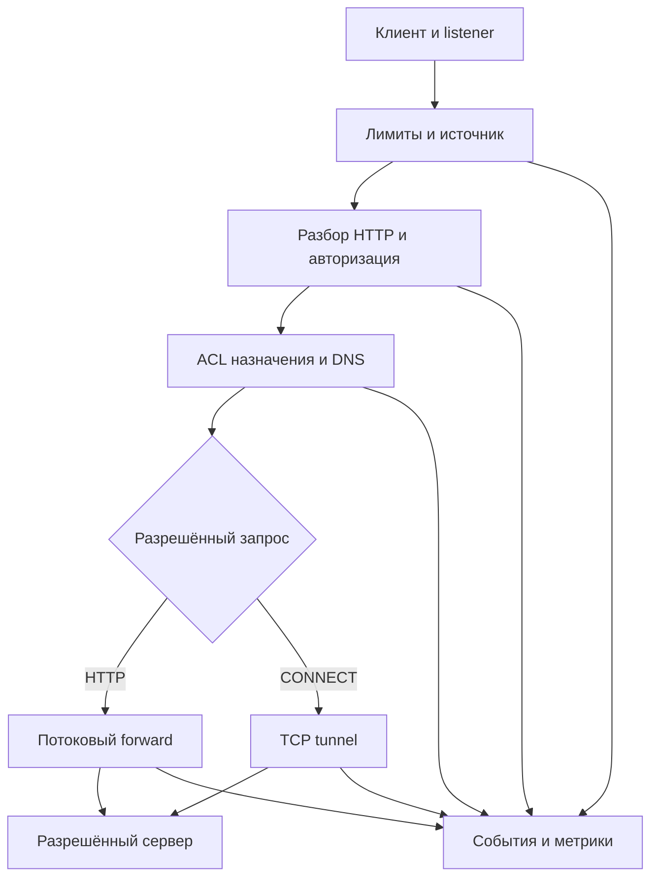

# Angara — проект архитектуры

Архитектура M00 согласована владельцем. M01–M07 приняты и слиты. Редакция 0.9 от 16 ноября 2026 года включает контракт установки и сопровождения кандидата. [M08-r1](tasks/M08_RELEASE_CANDIDATE.md)

## 1. Общая организация

Один асинхронный процесс с многопоточным Tokio runtime и один Rust crate с библиотечной частью для тестирования и небольшим CLI. Модули разделяют ответственность, но не вводят межпроцессную сеть, микросервисы или обязательную БД. Бинарный файл предварительно называется angara.

| Модуль | Ответственность | Чего он не решает |
| --- | --- | --- |
| cli | Команды serve, check, version; коды завершения | Политика запросов |
| config | Загрузка TOML, проверка, неизменяемый снимок поколения | Сетевое обслуживание |
| runtime | Запуск, лимиты, учёт задач, сигналы и завершение | Разбор HTTP |
| listener | Приём TCP, TLS-вход, получение реального peer address | Решение ACL |
| auth | Разбор proxy credentials и проверка локальных пользователей | Разрешение доступа к назначениям |
| policy | Правила источника, пользователя, authority и конечного IP | Выполнение сетевого соединения |
| target | Каноническое назначение, DNS, проверка IP-кандидатов | Самостоятельный обход ACL |
| routing | Выбор egress-профиля по listener, источнику, identity и назначению | Выдача права доступа вместо ACL |
| transport | Соединение с разрешённым endpoint через выбранный egress, deadlines и отмена | Повторное разрешение имени без проверки |
| control | Внутренние операции управления и ограниченные снимки состояния, по мере M07/M11 | Forwarding и обработка UI |
| proxy/http | HTTP/1.1 forwarding, заголовки и потоковые тела | Хранение пользовательских паролей |
| proxy/connect | Установка CONNECT и двусторонняя передача байтов | Расшифровка TLS сайта |
| telemetry | Структурированные события, счётчики и длительности | Сбор содержимого трафика |

Модули parent и cache обязательны в M09/M10; их подробные контракты фиксируются до реализации. До этого достаточно явных границ transport и HTTP forwarding; универсальная система плагинов не проектируется заранее.

## 2. Поток обработки

Последовательность одного запроса:

1. Ограничить число принятых соединений и время заголовков. Проверить допустимость адреса источника из TCP-сокета.
2. Для нового запроса зафиксировать одно поколение конфигурации. Разобрать запрос библиотекой HTTP. Проверить форму request-target, метод, authority, размер заголовков и неоднозначное framing.
3. По этому же снимку проверить источник и авторизацию, если она требуется для listener. При необходимости ответить 407 с Proxy-Authenticate. Не открывать соединение к назначению до успешной проверки.
4. Используя тот же снимок и полученную identity, проверить правила пользователя, домена, метода и порта. Auth и ACL одного запроса не могут брать разные поколения настроек.
5. Разрешить DNS-имя в ограниченный набор IP. Проверить каждый кандидат по IP-политике и встроенным ограничениям специальных диапазонов.
6. Выбрать egress-профиль детерминированными правилами; передать transport разрешённый SocketAddr, исходный authority и профиль. Соединяться именно с проверенным IP через выбранный профиль; новый DNS lookup и fallback на другой интерфейс не должны подменить решение.
7. Для HTTP передавать запрос и ответ с backpressure; для CONNECT сначала установить исходящее соединение, затем отправить успешный ответ и перейти к туннелю.
8. При завершении или ошибке освободить разрешения лимитов, задачи и сокеты; записать итог и объёмы передачи.

RequestContext содержит request_id, source address, identity, нормализованное authority, разрешённый endpoint, matched rule, listener_id, egress_id, config generation и deadlines. Секрет из Proxy-Authorization не является частью контекста наблюдаемости.

## 3. HTTP forwarding

- Вход — absolute-form HTTP URI. Выход к origin — корректная origin-form с согласованным Host. Несогласованность Host и authority отклоняется по документированной политике.
- Только поддержанные схемы и формы цели; userinfo и неверные authority отклоняются. У CONNECT порт обязателен; IPv6 literal разбирается со скобками.
- hop-by-hop заголовки и поля, перечисленные в Connection, не пересылаются как end-to-end. Обработка TE, trailers и Upgrade определяется явно, а не общим копированием заголовков.
- Proxy-Authorization потребляется Angara и не попадает на origin. Authorization сайта сохраняет свои end-to-end свойства. Поддельные X-Forwarded-For не становятся источником личности.
- Учитывать Via и относящиеся к proxy требования Max-Forwards. Петли маршрутизации не должны бесконечно продолжать запрос.
- Поддержать keep-alive, chunked framing, HEAD, 204, 304, информационные ответы и Expect: 100-continue в объёме согласованных тестов. Не сериализовать запрещённые тела по данным ответа.
- Не выполнять автоматический retry запроса после начала отправки, особенно для POST и потоковых тел. Допустимые повторы соединения до отправки описываются отдельно и ограничиваются.
- Range, If-Range и прочие end-to-end поля передаются без преобразования содержимого. Наличие Range не означает, что реализовано кэширование.
- HTTP Upgrade / WebSocket вне CONNECT в v0.1 не обещается. Неподдержанный Upgrade обрабатывается явно; нельзя возвращать 101 без перехода к корректному туннелю.
- Не писать собственный HTTP-парсер. hyper используется в строгой конфигурации; проверить его фактическое поведение на raw TCP-корпусе. Неоднозначные CL/TE, конфликтующие длины и недопустимые transfer codings должны завершаться безопасным отказом и закрытием соединения.

Большие тела не буферизуются целиком. Фиксируются ограничения заголовков, чанков передачи, ожидающих работ и соединений. При зависшем получателе чтение отправителя замедляется, а не накапливает тело в памяти.

## 4. CONNECT и два разных TLS-участка

CONNECT разрешается только к явно разрешённым портам, первоначально предлагается 443. Сначала проверяются источник, identity, домен и конечный IP; затем устанавливается TCP-соединение. Успешный ответ не содержит Content-Length или Transfer-Encoding.

После успешного ответа HTTP-парсер больше не интерпретирует содержимое туннеля. Буферизированные после заголовков байты сохраняются и передаются. Реализация сохраняет уже принятые данные при EOF и имеет ограниченное время завершения второго направления; требования RFC 9110 к закрытию туннеля закрепляются тестами. Таймауты и отмена должны прекращать обе стороны и освобождать ресурсы.

| Участок | Что делает Angara | Кто проверяет сертификат сайта |
| --- | --- | --- |
| Клиент → Angara по HTTP | Незашифрованный транспорт до прокси | Неприменимо |
| Клиент → Angara по HTTPS | TLS-listener с сертификатом прокси | Клиент проверяет сертификат прокси |
| Клиент → сайт внутри CONNECT | Передаёт непрозрачные байты | Клиент проверяет сертификат сайта |
| Angara → parent по TLS, будущий этап | TLS-клиент с проверкой имени и доверия | Angara проверяет сертификат parent |

HTTP/2 сайта внутри CONNECT возможен без HTTP/2 реализации Angara. HTTP/3 использует иной транспорт и не входит в TCP CONNECT v0.1.

## 5. ACL, DNS и назначение

Порядок — ранний source gate, обязательная авторизация listener, затем упорядоченные правила доступа по identity и назначению. Первое полностью совпавшее правило задаёт allow/deny; отсутствие совпадения означает deny. Ограничения конечного IP проверяются дополнительно для каждого кандидата. Точная схема TOML и композиция правил фиксируются до M02; не наследовать неявно синтаксис Squid.

Домены нормализуются одной функцией: регистр ASCII, завершающая точка, корректная IDNA-политика. Совпадение суффикса учитывает границу DNS-метки: правило example.com не разрешает notexample.com. Согласовать семантику «только домен» и «домен с поддоменами» отдельными полями.

По умолчанию блокируются loopback, private/local, link-local, multicast, unspecified и специальные диапазоны назначения; IPv4-mapped IPv6 нормализуется до проверки. Перечень диапазонов задаётся по актуальным специальным реестрам и проверяется тестами. Доступ к внутренним ресурсам включается явно администратором. Локальные интеграционные тесты используют отдельную разрешающую test-конфигурацию.

DNS-ответ не даёт разрешения сам по себе. Проверяется фактический IP каждого кандидата и порт; при отсутствии разрешённых кандидатов исходящего соединения нет. Повторные DNS-попытки и попытки соединения ограничены. Connection pool при повторном использовании проверяет endpoint, действующую политику и поколение; простой поиск соединения по имени не обходит новые ACL.

## 6. Авторизация

Первый backend — локальный файл пользователей с версионируемой схемой и salted Argon2id-хэшами. Параметры стоимости выбираются по измерениям; вычисления вынесены из async worker threads и ограничены отдельным semaphore/очередью. Ограничить размер credentials до декодирования и хэширования. Источник истины для identity — результат backend, не пользовательский заголовок.

Basic передаёт закодированные credentials и не обеспечивает шифрование. Поэтому аутентификация по незашифрованному соединению вне loopback по умолчанию запрещена конфигурацией; исключение для доверенной защищённой сети требует явного выбора администратора. TLS-listener входит в готовность v0.1.

Проверка выполняется на каждом HTTP-запросе, включая keep-alive и CONNECT. Отсутствующий, неверный и повреждённый credential не открывает upstream. Сообщения отказа не раскрывают наличие конкретного пользователя. Пароли не задаются в публичных аргументах команд и не выводятся в лог.

Кэш результатов проверки пароля не требуется на старте. Если он понадобится по профилю нагрузки, отдельно согласовать срок, предел размера, способ безопасного ключа, отзыв пользователей и поведение при reload.

## 7. Конфигурация и жизненный цикл

Предлагаемые команды: angara serve --config <path>, angara check --config <path>, angara --version. Полная схема и CLI — результат M01. Обычный запуск, listeners на портах выше 1024 и bind исходящего IP не требуют root. Привязка сокета к устройству изолирована как Linux-возможность и при необходимости проверяет доступные права; ради неё весь сервис не запускается от root.

M07 реализует reload через один immutable `RuntimeSnapshot` (generation, validated config, users snapshot и prepared TLS/egress references), опубликованный через `ArcSwap`. Generation начинается с 1 и увеличивается ровно на 1 после полной подготовки candidate; invalid/restart/busy/conflict/timeout не меняют её. Registry хранит только `Weak`-ссылки на живые roots и допускает не более 16 одновременно; при исчерпании возвращается `GenerationBusy`. Request/CONNECT захватывает strong snapshot после exchange gate, поэтому старый exchange заканчивается по своей policy/timers, а следующий keep-alive/pipelined request видит новый generation. Открытый CONNECT не отзывается немедленно.

Один preparation job (queue0) читает main TOML и users один раз в ограниченный buffer, проверяет TOML/PHC вне async workers и возвращает candidate. Admission guard удерживает единственный permit до publish/уничтожения готового результата, поэтому ready-but-not-consumed candidate не позволяет запустить второй; timeout/drop caller не освобождает слот фактически работающего native job. Публикация — короткая секция под lifecycle-mutex: expected generation, deadline, `Running` и generation cap проверяются вместе с CAS-заменой root. Caps публикуются до появления root, pool retire — после успешного CAS. Timeout/drop/shutdown снимает право публикации; поздний blocking candidate уничтожается. `status()/metrics()/validate_on_disk()/reload()/shutdown()` — внутренний Rust API; сетевого admin listener, Unix RPC, `/metrics` и CLI reload без IPC в M07 нет.

Hot-reload: `access.*`, `routing.*`, `auth.users_file` и содержимое users, глобальные `limits.max_connections`/`max_client_connections`, `limits.shutdown_timeout_ms`, request-таймауты `transport.total_timeout_ms`/`connect_timeout_ms`/`max_connect_attempts`, `http.response_header_timeout_ms`, `connect.allowed_ports`/`half_close_timeout_ms`. Workers, listeners/TLS, DNS, egress definitions, parser/idle/pool/auth-admission, `[operations]` и `[observability]` требуют restart; mixed hot+restart change отклоняется целиком. Reload не открывает cert/key: при прежних путях используются prepared Arcs, изменённый путь — `RestartRequired`. Startup/check продолжают полностью проверять файлы. Main TOML ограничен 1 MiB и на Linux читается из regular FD с проверкой owner/mode; users/TLS сохраняют прежние ограничения.

SIGHUP запускает тот же reload. Во время выполнения не более одного pending HUP; после завершения выполняется один дополнительный reload, без spawn на каждый signal. SIGTERM/SIGINT прерывают незавершённый reload до publish. Shutdown обслуживает один service-owned coordinator: первый absolute deadline/результат сохраняются, abort/timeout вызывающего future не отменяет force/reap, повторные вызовы ждут тот же результат. `HttpServer::shutdown`/`ControlState::shutdown`/CLI берут текущий hot `shutdown_timeout_ms` при первом запуске; уже начатый deadline не меняется. Lifecycle монотонен: `Stopped` не возвращается в `Draining`. Draining запрещает новые accepts/exchanges/handshakes/auth jobs и reload publish, закрывает idle origins и даёт уже допущенной работе оставшееся время. Повторные signals не продлевают deadline; после force sockets/tasks действительно закрываются/reap-ятся. Native DNS/Argon2/file jobs не обещают принудительный abort, но их permits остаются ограниченными.

## 8. Ограничения и наблюдаемость

| Ресурс | Предлагаемая граница |
| --- | --- |
| TCP-соединения | Общая и на источник; на identity после входа |
| Auth | Ограниченное число дорогих проверок и ограниченная очередь |
| DNS/connect | Предел параллелизма, числа попыток и срока |
| Заголовки | Максимум байтов, полей и время получения |
| Передача | Ограниченные буферы, idle timeout и необязательный максимальный срок туннеля |
| Connection pool | Максимум активных/свободных соединений и idle срок |
| Журналы | Ограниченная очередь с явным поведением при переполнении |
| Метрики | Ограниченный набор labels без URL, usernames и произвольных доменов |

Численные defaults выбираются в соответствующих заданиях и измеряются. Квоты байтов за период и гарантированное распределение bandwidth в v0.1 не обещаются.

M07 `serve` пишет JSON Lines только в stderr из typed allow-list: `schema_version=1`, wall-clock `timestamp_ms`, monotonic `elapsed_ms`, server-created connection/request IDs, config generation, configured listener/egress/rule IDs, HTTP status, outcome/reason enums, request/response DATA bytes, CONNECT plaintext bytes и bounded metrics summary. Exactly-once terminal guard создаётся при admission HTTP exchange и покрывает auth/DNS/ожидание headers/streaming/force; abort до тела пишет cancelled. CONNECT terminal создаётся сразу после exchange gate и хранит generation единственного snapshot: отмена setup до 200 (auth/DNS/dial) пишет request cancellation, отказ — `request_finished` со status/reason rejected, а не tunnel event. `request_finished` появляется после завершения/отмены streaming body; HEAD/пустое body = 0; `tunnel_finished` — только после реального writer drain CONNECT, потеря хвоста даёт failed/timeout. В M07 **не журналируются** usernames, PHC/passwords, Proxy-Authorization/Authorization/Cookie, произвольные headers/trailers, URL/path/query, authority/domain, source/destination IP, TLS material и payload. Record ≤4096 bytes; queue ограничена `log_queue_capacity`, переполнение — drop-newest с counters. Один CLI-owned stderr worker; library `HttpServer` не создаёт thread и использует no-op/caller-owned sink. Зависший pipe не продлевает общий shutdown deadline.

Метрики доступны локально через `ControlState::metrics()` и periodic JSON summary; сетевой admin API в v0.1 не требуется. Counters/gauges/fixed histograms глобальны, без user/domain/IP/generation labels; series ≤2048. Histogram bounds — `1,5,10,25,50,100,500,1000` ms + overflow. Reload не сбрасывает counters; `metrics_enabled=false` отключает detailed histograms/summary, но structural accounting и control status работают. `dns_active` принадлежит фактическому blocking lookup и не уменьшается при timeout/drop ожидающего future до завершения native job. Внутренние операции управления отделяются от протокольного пути, чтобы в M11 подключить локальный API и TUI. Доступ к диагностике не должен проходить через обычное клиентское проксирование.

## 9. Использование CPU-ядер

Runtime использует многопоточный scheduler Tokio; один процесс обслуживает много соединений задачами на нескольких workers. Настройка runtime.worker_threads поддерживает auto и явное положительное число. Auto учитывает доступный процессу параллелизм; ограничения контейнера/cpuset проверяются на стенде. Число потоков не равно числу соединений или устройств.

Проверка паролей, дисковые операции будущего cache и другие блокирующие работы не выполняются в сетевых async workers. У таких работ есть отдельные пределы параллелизма и очередей. Нельзя считать неограниченный spawn_blocking защитой от перегрузки. Config читается через неизменяемые снимки, счётчики не должны вводить один глобальный lock на передачу каждого блока трафика.

В M01 реально создаётся и проверяется многопоточный runtime без сетевого forwarding. В M03–M08 проверяется распределение работы при одновременных соединениях с 1/2/4 workers в пределах доступного железа; производительность измеряется отдельно. Не обещаются линейное ускорение одного туннеля и равномерная загрузка всех ядер при 10–20 устройствах. NUMA, affinity, SO_REUSEPORT и несколько процессов — последующая оптимизация по профилированию.

## 10. Несколько сетевых интерфейсов

Вход и выход настраиваются независимо:

| Объект | Контракт |
| --- | --- |
| Listener | Стабильный id, конкретный bind IP:port и HTTP/TLS transport; несколько listeners одновременно |
| Egress profile | Стабильный id, системный маршрут либо конкретный bind_ip; при поддержке Linux — явный bind_device |
| Route rule | Упорядоченное сопоставление listener/source/identity/назначения с egress_id; default задан явно |
| Dial | Проверенный IP назначения + egress-профиль; ошибка bind/connect не меняет профиль молча |
| Pool key | Назначение, egress_id, поколение/актуальная политика и все значимые transport/identity ограничения |

ACL решает, разрешён ли запрос. Routing выбирает путь только для уже разрешённого запроса. Минимум v0.1: несколько listeners и реально работающий bind исходящего IP с выбором профиля по правилам. Выбор Linux-устройства можно добавить в том же transport backend; неподдержанное поле не принимается молча.

Bind IP задаёт адрес источника, но не гарантирует выбор физического интерфейса: таблицы маршрутизации и policy routing Linux должны соответствовать профилю. Строгая привязка к устройству, права на неё и доступность маршрута проверяются отдельно. Angara не меняет маршруты, IP-адреса и firewall сервера при запуске. DNS по умолчанию использует системный resolver; изоляция DNS по исходящему интерфейсу потребует отдельного resolver backend и не подразумевается bind сокета данных.

Ошибка обязательного listener прерывает запуск и закрывает уже открытые listeners. Несовместимые IPv4/IPv6 bind, отсутствующий исходящий адрес, конфликты wildcard/listener и неизвестный egress_id дают явный отказ. Проверка check остаётся без сети; фактическая возможность bind проверяется в serve. При исчезновении исходящего адреса запросы завершаются ошибкой, без неявного выхода через другой профиль.

Connection pool не объединяет разные egress, parent credentials и TLS-параметры. Reload поколения не позволяет старому соединению обходить новые ACL. Будущий parent выбирается после проверки доступа и получает свой egress-профиль; TLS к parent использует тот же выбранный dial, затем проверяет сертификат по имени parent.

Тесты используют два локальных адреса для переносимого сценария и отдельный стенд с network namespaces/veth для подтверждения двух интерфейсов. Отсутствие прав для второго стенда отмечается как skip с причиной, не как доказанная поддержка NIC.

## 11. Управление, TUI и возможная web-панель

Ядро экспортирует типизированные операции control service; UI не получает прямого доступа к изменяемым внутренним структурам proxy. На M07 через этот слой оформляются статус, согласованный reload и завершение; сетевой сервер управления пока не нужен.

На M11 добавляются локальный версионируемый API и современный TUI. Для Ubuntu предпочтителен Unix domain socket с правами ОС. Минимальные экраны: статус/ресурсы, listeners и egress, активные соединения, пользователи, ACL, ошибки и проверка/применение конфигурации. Списки соединений и события имеют пагинацию/ограниченные буферы. TUI вызывает тот же validator и атомарное применение config, что CLI. При отключении TUI proxy продолжает работу.

Возможная M12-панель использует те же операции; ориентир bind — 127.0.0.1:7029, порт уточняется в задании и не является портом proxy. Панель выключена по умолчанию, независима от proxy listeners и не появляется в v0.1 без отдельной задачи. Loopback ограничивает сеть, но для изменения состояния всё равно нужны отдельная административная аутентификация, проверки Host/Origin и защита от CSRF. Учётная запись proxy не даёт административных прав автоматически. Приватные ключи и пароли API не возвращает.

Контракт управления допускает status, ограниченные metrics/events, check_config и apply_config с ожидаемым поколением, чтобы два клиента не перезаписывали изменения. Перезапуск процесса, немедленный отзыв туннелей и ротация сертификатов не становятся обещанными командами UI до реализации соответствующих операций ядра.

## 12. Обязательные будущие расширения

Parent proxy получает собственный backend transport и отдельные credentials. Нельзя переслать клиентский Proxy-Authorization родителю как его credential. Проверка TLS parent, петли, CONNECT через parent и ошибки маршрута требуют отдельного задания.

HTTP cache подключается между разрешением запроса и HTTP forward. Доступ проверяется до чтения из кэша. Политика обязана учитывать Cache-Control, Vary, freshness, validators и разделение пользователей. Первая ограниченная версия может обходить Authorization, Cookie, Range, Set-Cookie и неподдержанные Vary; это консервативное ограничение Angara, не утверждение, что RFC запрещает кэшировать их во всех случаях. CONNECT и TLS содержимого сайтов в кэш не входят. Дисковый cache, crash recovery и eviction планируются после корректного ограниченного cache.

## 13. Граница установки и процесса в M08

Системная установка управляет версионными каталогами под `/opt/angara`, активной версией и unit. Конфигурация и секреты принадлежат администратору и переживают обновление. Процесс читает их от служебной учётной записи `angara`. Переключение версии, запуск и откат проверяются на реальном systemd через запрос к прокси.

Systemd передаёт SIGHUP и SIGTERM существующему процессу. Сохранение политики при отклонённом reload проверяется следующим запросом. Внешний срок остановки покрывает максимальное значение `limits.shutdown_timeout_ms` в приложении. Внутренний сервис управления остаётся основой для будущих интерфейсов. [M08-r1](tasks/M08_RELEASE_CANDIDATE.md)

## 14. Основания и ограничения

Протокол: [RFC 9110](https://www.rfc-editor.org/rfc/rfc9110.html), [RFC 9112](https://www.rfc-editor.org/rfc/rfc9112.html), будущий cache — [RFC 9111](https://www.rfc-editor.org/rfc/rfc9111.html). Реализация HTTP — [hyper](https://hyper.rs/guides/1/server/hello-world/), ограничения async очередей — [Tokio](https://tokio.rs/tokio/tutorial/channels), TLS — [rustls](https://rustls.dev/docs/rustls/index.html).

Выбор библиотек не доказывает корректность прокси: нормализация целей, ACL, заголовки, лимиты и жизненный цикл требуют отдельных реализаций и проверок. Точные версии и дополнительные зависимости закрепляются в ближайшем задании. Источники многопоточности и socket bind: [Tokio runtime](https://docs.rs/tokio/latest/tokio/runtime/), [TcpSocket](https://docs.rs/tokio/latest/tokio/net/struct.TcpSocket.html); взаимодействие устройства с маршрутами — [Linux VRF](https://www.kernel.org/doc/html/latest/networking/vrf.html).
