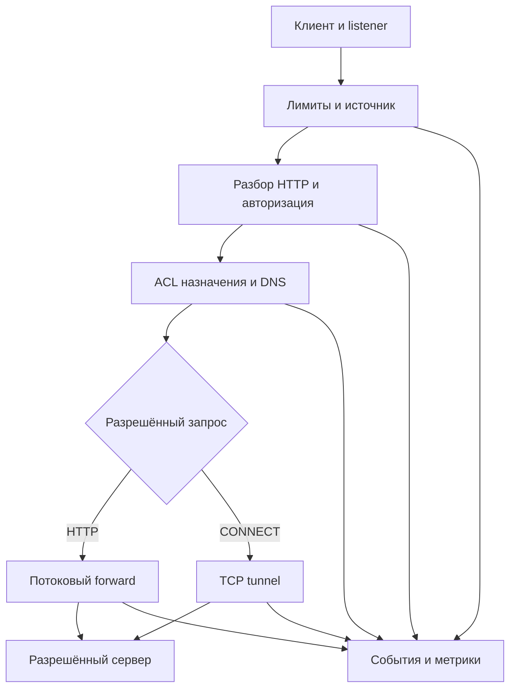

# Angara — проект архитектуры

Статус: **PROPOSED / M00 не согласован**. Ревизия 0.1, 9 ноября 2026 года. Документ предполагает одобрение Rust; при выборе другого языка сохраняются границы ответственности и требования протокола.

## 1. Общая организация

Один асинхронный процесс и один Rust crate с библиотечной частью для тестирования и небольшим CLI. Модули разделяют ответственность, но не вводят межпроцессную сеть, микросервисы или обязательную БД. Бинарный файл предварительно называется angara.

| Модуль | Ответственность | Чего он не решает |
| --- | --- | --- |
| cli | Команды serve, check, version; коды завершения | Политика запросов |
| config | Загрузка TOML, проверка, неизменяемый снимок поколения | Сетевое обслуживание |
| runtime | Запуск, лимиты, учёт задач, сигналы и завершение | Разбор HTTP |
| listener | Приём TCP, TLS-вход, получение реального peer address | Решение ACL |
| auth | Разбор proxy credentials и проверка локальных пользователей | Разрешение доступа к назначениям |
| policy | Правила источника, пользователя, authority и конечного IP | Выполнение сетевого соединения |
| target | Каноническое назначение, DNS, проверка IP-кандидатов | Самостоятельный обход ACL |
| transport | Соединение с разрешённым endpoint, deadlines и отмена | Повторное разрешение имени без проверки |
| proxy/http | HTTP/1.1 forwarding, заголовки и потоковые тела | Хранение пользовательских паролей |
| proxy/connect | Установка CONNECT и двусторонняя передача байтов | Расшифровка TLS сайта |
| telemetry | Структурированные события, счётчики и длительности | Сбор содержимого трафика |

Будущие модули parent и cache вводятся отдельными решениями. До этого достаточно явных границ transport и HTTP forwarding; универсальная система плагинов не проектируется заранее.

## 2. Поток обработки

Последовательность одного запроса:

1. Ограничить число принятых соединений и время заголовков. Проверить допустимость адреса источника из TCP-сокета.
2. Для нового запроса зафиксировать одно поколение конфигурации. Разобрать запрос библиотекой HTTP. Проверить форму request-target, метод, authority, размер заголовков и неоднозначное framing.
3. По этому же снимку проверить источник и авторизацию, если она требуется для listener. При необходимости ответить 407 с Proxy-Authenticate. Не открывать соединение к назначению до успешной проверки.
4. Используя тот же снимок и полученную identity, проверить правила пользователя, домена, метода и порта. Auth и ACL одного запроса не могут брать разные поколения настроек.
5. Разрешить DNS-имя в ограниченный набор IP. Проверить каждый кандидат по IP-политике и встроенным ограничениям специальных диапазонов.
6. Передать transport разрешённый SocketAddr вместе с исходным authority. Соединяться именно с проверенным IP; новый DNS lookup не должен подменить его.
7. Для HTTP передавать запрос и ответ с backpressure; для CONNECT сначала установить исходящее соединение, затем отправить успешный ответ и перейти к туннелю.
8. При завершении или ошибке освободить разрешения лимитов, задачи и сокеты; записать итог и объёмы передачи.

RequestContext содержит request_id, source address, identity, нормализованное authority, разрешённый endpoint, matched rule, config generation и deadlines. Секрет из Proxy-Authorization не является частью контекста наблюдаемости.

## 3. HTTP forwarding

- Вход — absolute-form HTTP URI. Выход к origin — корректная origin-form с согласованным Host. Несогласованность Host и authority отклоняется по документированной политике.
- Только поддержанные схемы и формы цели; userinfo и неверные authority отклоняются. У CONNECT порт обязателен; IPv6 literal разбирается со скобками.
- hop-by-hop заголовки и поля, перечисленные в Connection, не пересылаются как end-to-end. Обработка TE, trailers и Upgrade определяется явно, а не общим копированием заголовков.
- Proxy-Authorization потребляется Angara и не попадает на origin. Authorization сайта сохраняет свои end-to-end свойства. Поддельные X-Forwarded-For не становятся источником личности.
- Учитывать Via и относящиеся к proxy требования Max-Forwards. Петли маршрутизации не должны бесконечно продолжать запрос.
- Поддержать keep-alive, chunked framing, HEAD, 204, 304, информационные ответы и Expect: 100-continue в объёме согласованных тестов. Не сериализовать запрещённые тела по данным ответа.
- Не выполнять автоматический retry запроса после начала отправки, особенно для POST и потоковых тел. Допустимые повторы соединения до отправки описываются отдельно и ограничиваются.
- Range, If-Range и прочие end-to-end поля передаются без преобразования содержимого. Наличие Range не означает, что реализовано кэширование.
- HTTP Upgrade / WebSocket вне CONNECT в v0.1 не обещается. Неподдержанный Upgrade обрабатывается явно; нельзя возвращать 101 без перехода к корректному туннелю.
- Не писать собственный HTTP-парсер. hyper используется в строгой конфигурации; проверить его фактическое поведение на raw TCP-корпусе. Неоднозначные CL/TE, конфликтующие длины и недопустимые transfer codings должны завершаться безопасным отказом и закрытием соединения.

Большие тела не буферизуются целиком. Фиксируются ограничения заголовков, чанков передачи, ожидающих работ и соединений. При зависшем получателе чтение отправителя замедляется, а не накапливает тело в памяти.

## 4. CONNECT и два разных TLS-участка

CONNECT разрешается только к явно разрешённым портам, первоначально предлагается 443. Сначала проверяются источник, identity, домен и конечный IP; затем устанавливается TCP-соединение. Успешный ответ не содержит Content-Length или Transfer-Encoding.

После успешного ответа HTTP-парсер больше не интерпретирует содержимое туннеля. Буферизированные после заголовков байты сохраняются и передаются. Реализация сохраняет уже принятые данные при EOF и имеет ограниченное время завершения второго направления; требования RFC 9110 к закрытию туннеля закрепляются тестами. Таймауты и отмена должны прекращать обе стороны и освобождать ресурсы.

| Участок | Что делает Angara | Кто проверяет сертификат сайта |
| --- | --- | --- |
| Клиент → Angara по HTTP | Незашифрованный транспорт до прокси | Неприменимо |
| Клиент → Angara по HTTPS | TLS-listener с сертификатом прокси | Клиент проверяет сертификат прокси |
| Клиент → сайт внутри CONNECT | Передаёт непрозрачные байты | Клиент проверяет сертификат сайта |
| Angara → parent по TLS, будущий этап | TLS-клиент с проверкой имени и доверия | Angara проверяет сертификат parent |

HTTP/2 сайта внутри CONNECT возможен без HTTP/2 реализации Angara. HTTP/3 использует иной транспорт и не входит в TCP CONNECT v0.1.

## 5. ACL, DNS и назначение

Порядок — ранний source gate, обязательная авторизация listener, затем упорядоченные правила доступа по identity и назначению. Первое полностью совпавшее правило задаёт allow/deny; отсутствие совпадения означает deny. Ограничения конечного IP проверяются дополнительно для каждого кандидата. Точная схема TOML и композиция правил фиксируются до M02; не наследовать неявно синтаксис Squid.

Домены нормализуются одной функцией: регистр ASCII, завершающая точка, корректная IDNA-политика. Совпадение суффикса учитывает границу DNS-метки: правило example.com не разрешает notexample.com. Согласовать семантику «только домен» и «домен с поддоменами» отдельными полями.

По умолчанию блокируются loopback, private/local, link-local, multicast, unspecified и специальные диапазоны назначения; IPv4-mapped IPv6 нормализуется до проверки. Перечень диапазонов задаётся по актуальным специальным реестрам и проверяется тестами. Доступ к внутренним ресурсам включается явно администратором. Локальные интеграционные тесты используют отдельную разрешающую test-конфигурацию.

DNS-ответ не даёт разрешения сам по себе. Проверяется фактический IP каждого кандидата и порт; при отсутствии разрешённых кандидатов исходящего соединения нет. Повторные DNS-попытки и попытки соединения ограничены. Connection pool при повторном использовании проверяет endpoint, действующую политику и поколение; простой поиск соединения по имени не обходит новые ACL.

## 6. Авторизация

Первый backend — локальный файл пользователей с версионируемой схемой и salted Argon2id-хэшами. Параметры стоимости выбираются по измерениям; вычисления вынесены из async worker threads и ограничены отдельным semaphore/очередью. Ограничить размер credentials до декодирования и хэширования. Источник истины для identity — результат backend, не пользовательский заголовок.

Basic передаёт закодированные credentials и не обеспечивает шифрование. Поэтому аутентификация по незашифрованному соединению вне loopback по умолчанию запрещена конфигурацией; исключение для доверенной защищённой сети требует явного выбора администратора. TLS-listener входит в готовность v0.1.

Проверка выполняется на каждом HTTP-запросе, включая keep-alive и CONNECT. Отсутствующий, неверный и повреждённый credential не открывает upstream. Сообщения отказа не раскрывают наличие конкретного пользователя. Пароли не задаются в публичных аргументах команд и не выводятся в лог.

Кэш результатов проверки пароля не требуется на старте. Если он понадобится по профилю нагрузки, отдельно согласовать срок, предел размера, способ безопасного ключа, отзыв пользователей и поведение при reload.

## 7. Конфигурация и жизненный цикл

Предлагаемые команды: angara serve --config <path>, angara check --config <path>, angara --version. Полная схема и CLI — результат M01. Бинарник работает без root; порт выше 1024 не требует привилегированного bind.

При reload: прочитать, проверить и подготовить новый снимок полностью; только затем атомарно опубликовать новое поколение. При ошибке остаётся прежняя конфигурация. Запрос, уже начатый на старом снимке, заканчивается по его политике; следующий запрос на keep-alive берёт новый снимок. CONNECT оценивается при установке и живёт до завершения/таймаута. Немедленный отзыв уже открытых туннелей — отдельная функция, если владелец её потребует.

В v0.1 online reload охватывает ACL, пользователей и лимиты, допускающие безопасную замену. Изменение адресов listener и сертификатов требует перезапуска; попытка такого reload отклоняется целиком с понятным сообщением. Поддержка ротации сертификатов без restart — отдельное расширение.

SIGTERM прекращает приём, даёт активным операциям ограниченное время и завершает оставшиеся. Все задачи отслеживаются; detached tasks не переживают закрытие сервиса бесконтрольно.

## 8. Ограничения и наблюдаемость

| Ресурс | Предлагаемая граница |
| --- | --- |
| TCP-соединения | Общая и на источник; на identity после входа |
| Auth | Ограниченное число дорогих проверок и ограниченная очередь |
| DNS/connect | Предел параллелизма, числа попыток и срока |
| Заголовки | Максимум байтов, полей и время получения |
| Передача | Ограниченные буферы, idle timeout и необязательный максимальный срок туннеля |
| Connection pool | Максимум активных/свободных соединений и idle срок |
| Журналы | Ограниченная очередь с явным поведением при переполнении |
| Метрики | Ограниченный набор labels без URL, usernames и произвольных доменов |

Численные defaults выбираются в соответствующих заданиях и измеряются. Квоты байтов за период и гарантированное распределение bandwidth в v0.1 не обещаются.

Событие содержит время, request_id, identity или локальный идентификатор по согласованной политике, источник, authority, matched rule, код исхода, config generation, длительность и байты каждого направления. Полный URL с query и пользовательские заголовки по умолчанию не журналируются. Proxy-Authorization, Authorization, Cookies, пароли и payload исключены. Если source IP и identity сохраняются, администратор определяет доступ и срок хранения журналов.

Метрики предлагаются локально или на Unix socket; отдельный публичный административный HTTP API в v0.1 не нужен. Доступ к диагностике не должен проходить через обычное клиентское проксирование.

## 9. Будущие расширения

Parent proxy получает собственный backend transport и отдельные credentials. Нельзя переслать клиентский Proxy-Authorization родителю как его credential. Проверка TLS parent, петли, CONNECT через parent и ошибки маршрута требуют отдельного задания.

HTTP cache подключается между разрешением запроса и HTTP forward. Доступ проверяется до чтения из кэша. Политика обязана учитывать Cache-Control, Vary, freshness, validators и разделение пользователей. Первая ограниченная версия может обходить Authorization, Cookie, Range, Set-Cookie и неподдержанные Vary; это консервативное ограничение Angara, не утверждение, что RFC запрещает кэшировать их во всех случаях. CONNECT и TLS содержимого сайтов в кэш не входят. Дисковый cache, crash recovery и eviction планируются после корректного ограниченного cache.

## 10. Основания и ограничения

Протокол: [RFC 9110](https://www.rfc-editor.org/rfc/rfc9110.html), [RFC 9112](https://www.rfc-editor.org/rfc/rfc9112.html), будущий cache — [RFC 9111](https://www.rfc-editor.org/rfc/rfc9111.html). Реализация HTTP — [hyper](https://hyper.rs/guides/1/server/hello-world/), ограничения async очередей — [Tokio](https://tokio.rs/tokio/tutorial/channels), TLS — [rustls](https://rustls.dev/docs/rustls/index.html).

Выбор библиотек не доказывает корректность прокси: нормализация целей, ACL, заголовки, лимиты и жизненный цикл требуют отдельных реализаций и проверок. Точные версии и дополнительные зависимости не утверждены этим предложением.
