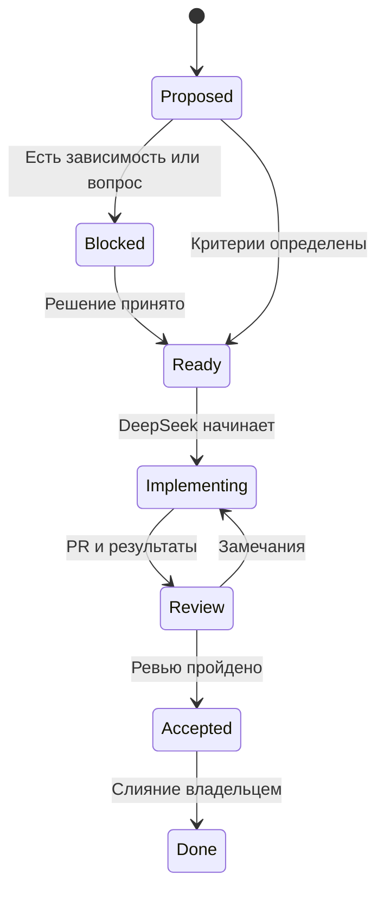

# Angara — совместная работа через GitHub

Процесс согласован в M00. Редакция 1.0 от 20 ноября 2026 года. Claude (с 17 ноября 2026 года; до этого Codex) планирует и проводит ревью. DeepSeek V4.1 Flash 1017 реализует код, тесты и CI. Задания и результаты хранятся в GitHub.

## Источники истины

| Объект | Что хранит |
| --- | --- |
| docs/PROJECT_BRIEF.md | Согласованные требования и границы продукта |
| docs/ARCHITECTURE.md | Действующие контракты и компоненты |
| docs/DECISIONS.md | Кто, когда и что предложил или утвердил |
| docs/ROADMAP.md | Порядок и состояние этапов |
| Issue | Конкретное задание, зависимости и критерии |
| PR | Код, тесты, результаты и обсуждение ревью |

Решение владельца из чата записывается в DECISIONS и соответствующее Issue. До этого утверждение модели о согласовании не является подтверждением. Владелец подтвердил M00 9 ноября 2026 года; это снимает блокировку требований для M01, но само по себе не поручает слияние PR.

M08 принят и слит ([M08-r1](tasks/M08_RELEASE_CANDIDATE.md), [Issue #23](https://github.com/AlexiVladSmol/Angara/issues/23), PR #25). Доработки ведутся отдельными Issue со статусом Ready: ветка `fix/<issue>-<name>` от актуального `main`, в PR — `Closes #<issue>`, полный SHA и чем подтверждён каждый пункт задания. Ревью публикуется комментарием в PR и копией в `docs/reviews/` (D56). Выпуск кандидата в эксплуатацию решает владелец.

## Жизненный цикл задания

Статусы сначала могут быть текстом в Issue. Labels и GitHub Projects необязательны. Статус Ready допускается только после необходимых согласований. Открытый PR, зелёный CI и Accepted на старом SHA не переводят задачу автоматически в Done.

## Задание Codex → DeepSeek

Каждое Issue включает:

1. Цель и наблюдаемое изменение поведения.
2. Ссылки на согласованные документы и исходный SHA/ветку.
3. Зависимости, что входит и что не входит в задание.
4. Контракты компонентов, конфигурации и ошибок, если меняются.
5. Критерии приёмки в виде проверяемых результатов.
6. Обязательные положительные, отрицательные, граничные и ресурсные сценарии.
7. Ожидаемые результаты: код, тесты, документы, CI evidence.
8. Условия остановки: неясный контракт, новая архитектурная развилка, недоступные обязательные проверки.

DeepSeek оставляет короткий план, выполняет задание и открывает PR. Если требуется решение, формулирует конкретный вопрос с вариантами и влиянием. Самостоятельно расширять scope или отключать проверку ради зелёного CI нельзя.

## Отчёт DeepSeek в PR

- Issue и реализованные требования.
- Base/head SHA и краткое описание изменения.
- Какие проверки выполнены: команды, среда, итог и ссылки на runs.
- Новые негативные сценарии и связь с TEST_STRATEGY ID.
- Что не проверено и почему; оставшиеся ограничения.
- Конфигурационная совместимость и инструкция ручной проверки, если нужна.

Не публиковать реальные credentials и приватные пользовательские логи. Использовать синтетические fixtures и временную CA для тестов.

## Ревью Codex → DeepSeek

Codex проверяет актуальный head, требования, diff и результаты. Замечание оформляется с местом, наблюдаемым последствием и ожидаемой проверкой. Приоритеты:

| Уровень | Значение |
| --- | --- |
| P0 | Критичная утечка/обход политики/повреждение; блокирует использование |
| P1 | Существенная ошибка корректности, протокола или ресурсов; блокирует принятие |
| P2 | Ограниченный дефект или недостающая проверка; решение явно фиксируется |
| P3 | Улучшение ясности и сопровождения; не маскируется под блокер |

Заключение содержит ACCEPTED, CHANGES_REQUESTED или BLOCKED, проверенный SHA и перечень фактически просмотренных/выполненных проверок. Новые коммиты требуют проверки изменённой части и соответствующих регрессий. Владелец решает спорные требования и принимает слияние.

Если обе среды пишут от AlexeiSmol, авторство GitHub не доказывает, какая модель выполнила работу; каждый отчёт подписывается ролью в тексте. GitHub не позволяет засчитать некоторые действия review собственного PR: в таком случае Codex публикует содержательное заключение комментарием. Независимый обязательный approval потребует другого GitHub-пользователя или reviewer.

## Ограничения автоматизации

Репозиторий обеспечивает хранение сообщений, но сам не запускает DeepSeek и Codex. В обычном режиме владелец запускает DeepSeek в OpenCode на нужном Issue, а Codex просит проверить конкретный PR. Опрос, webhook или CI-интеграция с API моделей могут быть спроектированы отдельно после согласования прав, запуска и лимитов.

Не обещается непрерывное наблюдение за репозиторием без такой настройки. При недоступности прямого GitHub-доступа владелец переносит текст, сохраняя Issue, SHA и результаты; после восстановления сведения возвращаются в репозиторий.

## Передача контекста и завершение сессии

Короткий checkpoint в Issue/PR: роль, текущий SHA, что принято, что изменено, результаты, открытые блокеры и следующее действие. Не использовать огромную историю чата как единственное хранилище требований. Исполнитель следующей сессии читает документы и checkpoint, затем проверяет актуальное состояние ветки.
